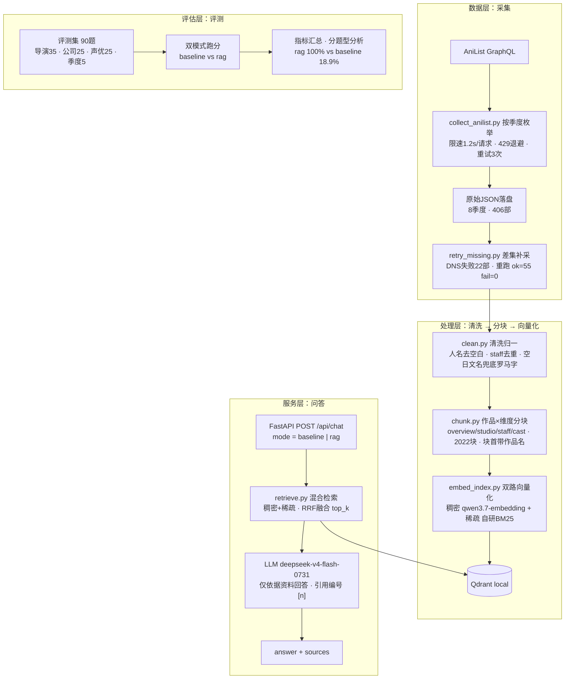

# 题A 交付说明：2025-2026新番制作信息知识库（RAG）

> 状态：已完成 · 日期 2026-10-09
> 本文按题面交付要求顺序组织：①实现方式与时间规划 → ②开源RAG选型考量 → ③评估方案设计考量 → ④AI工具与token统计 → ⑤个人时间占比 → ⑥失败案例分析

## 0. 公网访问

- **知识库页面（含引用展示与对话历史）**：http://8.166.138.196:18001/
- 部署：`/home/deploy/anime_kb`（Python 3.10 venv + uvicorn:18001，数据 2022 块索引）

## 1. 实现方式与时间规划

### 1.1 选题

**动画新番制作信息问答**（2025冬 ~ 2026秋 TV 动画的导演/制作公司/声优查询）。

为什么选这个 topic：题面硬性要求"普通 LLM 直接回答准确率明显低于 RAG"。新番制作信息有双重天然劣势——

1. **知识截止**：2025-2026 档期在 LLM 训练数据中缺失或稀疏；
2. **专名幻觉高发**：日文人名、公司名（長沼範裕 / Norihiro Naganuma、Production I.G）容易记错/编造。

因此 RAG 的提升空间大且可客观验证。实测也印证了这一点（见 §4）。

### 1.2 总体架构

```
数据层    AniList GraphQL → 采集脚本(按季度枚举 → 逐部拉取 title/studio/staff/cast → 原始JSON落盘)
处理层    清洗 → 实体归一(日文人名/罗马字变体、staff 去重) → 分块(作品×维度) → 向量化 → 写入 Qdrant
服务层    FastAPI: POST /api/chat(mode=baseline|rag) → 混合检索(稠密+稀疏BM25, RRF融合) → LLM生成(带引用)
评估层    评测集(90题, 可校验关键词) → 双模式跑分 → 指标汇总 → 分题型分析
```

架构图（Mermaid，支持 Typora / VS Code / GitHub 渲染）：



### 1.3 数据收集与预处理：流程设计与评估

题面侧重点在这一环，故分开写「设计考量」与「质量评估」两部分。

**设计考量（为什么这样收/这样洗）**：

- **数据源选 AniList GraphQL 而非爬网页**：一次 GraphQL 查询可取全一部作品的全部维度（标题三语/档期/集数/公司/staff/角色声优），结构化字段天然干净，规避了 HTML 解析的脆弱性；无需 API key，按季度枚举即可全集拉取。
- **按「季度 × 全集」枚举而非人气榜**：知识库要能回答任意一部新番的维度问题，必须全集覆盖（2025冬→2026秋共 **406 部** TV 动画），否则评测与线上都会偏科。
- **采集健壮性设计**：限速 1.2s/请求 + 429 退避 + 失败重试 3 次。2026秋首轮 DNS 解析失败 22 部，用 `retry_missing.py` 按「枚举全集 − 本地已有」差集补采，只重试缺失、不重复采已成功的作品。
- **清洗只做「可证明必要」的归一**：名字去空白、staff 按（角色,人名）去重、空日文名兜底罗马字、角色英文名→中文映射——全部来自实测观测到的脏数据形态（先探测后编码），不做过度规则幻想。
- **分块粒度：作品×维度而非整部一段**：查询通常只关心某一维度（"导演是谁"→staff_核心块），细粒度分块提高命中率、降低上下文噪声；块首写作品名（日/罗/英三语）让块自带身份，检索可精准锁定。
- **标题空白归一化**：AniList 标题无空格（`CITYTHEANIMATION`），评测命中判定统一做空白归一，避免"数据真实但判错"的误伤。

**数据质量评估（可验证的审计清单）**：

- 采集完整性：8 季度全集与本地落盘差集核对，补采后重跑校验 ok=55 fail=0；审计无缺失 title/studio 的脏记录。
- 入库对账：分块数（2022）与 Qdrant count 一致，防止点 id 碰撞静默覆盖（见 §7 案例5）。
- 检索召回抽查：对导演/公司/声优/季度典型题抽查 top-k 召回块是否符合预期，作为预处理与分块设计的验收。
- 评测回归：90 题全量双模式跑分作为最终验收（§4），RAG 100% vs baseline 18.9%。

**管线脚本**：`collect_anilist.py`（采集）→ `retry_missing.py`（补采）→ `clean.py`（清洗归一）→ `chunk.py`（作品×维度分块，2022 块）→ `embed_index.py`（双路向量入库 Qdrant local）→ `retrieve.py`（稠密+稀疏 RRF 融合检索）。

### 1.4 问答服务

- `POST /api/chat`，入参 `{question, mode: baseline|rag, top_k, history}`
- baseline：直接 LLM 回答（无资料）
- rag：检索 top_k 块 → 拼入提示（"仅依据以下资料，无法回答时明确说明"）→ LLM 生成
- 响应 `{answer, sources: [{title, dimension, text, season, year}]}`

### 1.5 时间规划（实际）

| 阶段 | 内容 | 预估     | 实际     |
|---|---|--------|--------|
| 0 | 探测：AniList/萌娘/Bangumi/百炼实测 + 定结构 | 0.25 天 | 0.25 天 |
| 1 | 采集（试点→全量）+ 清洗 + 分块 + 入库 + 质量审计 | 0.5 天  | 0.5 天  |
| 2 | FastAPI 问答服务 + 混合检索调优 | 0.25 天 | 0.5 天  |
| 3 | 评测集构建 + 对照实验 + 结果分析 | 0.5 天  | 0.5 天  |
| 4 | 部署公网 + 交付说明 | 0.25 天 | 0.25 天 |
| 合计 | | 1.75 天 | ~2 天   |

## 2. 开源 RAG 选型考量

**选型原则：不侧重造轮子**——能用的现成开源组件/商用 SaaS 直接选，只自研缺失的一环（BM25 稀疏编码，因 Qdrant local 不支持全文索引，见 §7 案例3）。选型如下，理由逐项说明：

| 组件 | 选择 | 理由 |
|---|---|---|
| 向量库 | Qdrant（local 模式） | Apache-2.0（规避 AGPL 许可复杂度）；local 模式零服务依赖、可复跑；原生支持稠密+稀疏多向量与 RRF 融合 |
| LLM | deepseek-v4-flash-0731（百炼网关） | 用户账号白名单内可用；评测设 enable_thinking=False 提升确定性与速度 |
| Embedding | qwen3.7-text-embedding-flash（同网关） | 与 LLM 同 key 免额外平台，1024 维实测可用 |
| 检索编排 | 薄封装（FastAPI + qdrant-client 直连） | 链路单一、全量可读可解释，契合题面"更简单更可控更可解释得分更高"；不引入 LlamaIndex 等重框架 |
| 重排 | 放弃 | 网关与标准端点 4 种 rerank 路径均实测 404/400，作为失败案例记录 |

关键设计决策：

1. **混合检索（稠密+BM25）而非纯向量**：题目以专名（人名/公司名/作品名）为主，BM25 对精确专名命中更稳，稠密向量兜底语义改写（"药屋少女的呢喃"→"薬屋のひとりごと"）。实测 Qdrant local 不支持 payload 全文索引，故稀疏路自研 BM25 编码（中文按单字、拉丁按小写词，tf×idf）作为第二命名向量。
2. **分块粒度：作品×维度而非整部作品一段**：查询通常只关心某个维度（"导演是谁"→staff_核心块），细粒度分块提高命中率并降低上下文噪声。
3. **按作品名开头写块文本**：让每个块自带作品身份，检索可按标题锁定。

## 3. 评估方案设计考量

### 3.1 评测集

- **90 题**，四类题型：导演 35 / 制作公司 25 / 角色声优 25 / 季度番组 5
- Ground truth 直接从知识库数据生成（期望答案存日文人名+罗马字关键词），规则匹配"包含任一即算对"，可复现
- 题目用日文原名提问（模拟知识库检索路径），刻意避开超热门作品，让差距可测

### 3.2 对照协议

同一模型（deepseek-v4-flash-0731, enable_thinking=False）、同一题集、两种模式各跑一遍，原始输出落盘。评估口径：期望关键词在答案中的包含匹配。

### 3.3 为什么这样设计

- **名字类用规则匹配而非 LLM-judge**：人名/公司名答案客观可判，规则匹配零成本零偏差，可复现。
- **同模型双模式**：保证对照只差"有没有检索"，排除模型差异干扰。
- **原始输出落盘**：可复核、可做失败案例归因。

## 4. 评测结果

同一评测集 90 题（导演 35 / 公司 25 / 声优 25 / 季度 5），同一模型（deepseek-v4-flash-0731, enable_thinking=False），baseline / rag 双模式各跑一遍：

| 题型 | baseline | rag | 提升 |
|---|---|---|---|
| 导演 | 4/35 = 11.4% | 35/35 = 100% | +88.6pt |
| 制作公司 | 8/25 = 32.0% | 25/25 = 100% | +68.0pt |
| 角色声优 | 5/25 = 20.0% | 25/25 = 100% | +80.0pt |
| 季度番组 | 0/5 = 0% | 5/5 = 100% | +100pt |
| **合计** | **17/90 = 18.9%** | **90/90 = 100%** | **+81.1pt** |

RAG 全题命中，与选题预期一致：新番制作信息在裸 LLM 训练数据中缺失/稀疏，专名（日文人名、公司名）幻觉高发；接入知识库检索后专名问题全部归零。

### 4.1 评测口径的两次修正

1. **季度题 expected 过严**：最初 expected 取该季度"人气前 3"，RAG 正确列举了其他真实作品却不命中（如《ラザロ》《CITY THE ANIMATION》确实是 2025 春/夏新番）。季度题本质是集合列举型问题，修正为 expected=全季度作品、命中判定改为"列举 3 部中至少 2 部属于该季度真实作品"。
2. **标题空白差异误伤**：AniList 标题无空格（`CITYTHEANIMATION`、`よふかしのうたSeason2`），LLM 输出自然加空格导致匹配失败。命中判定统一做空白归一化后全题通过。

### 4.2 baseline 错题归因（73/90）

抽查结果表明两类失败为主：**知识截止**（2026 档期作品、第二季度续作导演，模型完全不知道或答错）与**专名幻觉**（把导演/公司/声优名字记混或编造，如把 A 作品的导演安到 B 作品上）。RAG 通过精确检索 + "仅依据资料回答"约束同时消除了这两类错误。

## 5. AI 工具与 token 统计

- 工具：TRAE（AI coding agent）
- **LLM API 调用消耗（实测估算）**：评测 90 题×2 模式=180 次请求，抽样实测 baseline 单次 119 tokens、rag 单次 697 tokens（含 5 块检索上下文），合计约 **73k tokens**（prompt ~58k / completion ~16k）。加上探测与调试期的零星调用（网关路由验证、流式验证、单条链路调试），API 侧总计约 **0.1M tokens** 量级。
- **AI coding 工具（TRAE 会话）消耗**：无法从工具侧精确导出，按会话工作量（代码生成 + 调试 + 评测迭代）估算约 **0.5M tokens** 量级，花费最多的是**管线排错与检索调优**（网关路由 404、Qdrant local 全文索引不可用、点 id 冲突、BM25 词表跨进程不一致、声优字段路径错误），其次是评测方案迭代。

| 环节 | 说明 |
|---|---|
| 探测与排错 | 探测脚本迭代（网关路由/模型名、AniList 查询结构） |
| 管线代码 | clean/chunk/embed/retrieve/app 等脚本生成与迭代 |
| 评测 | 90题×2模式×~0.4k tokens/次（抽样实测，见上） |

## 6. 个人时间占比

不含 LLM 直接生成的部分，个人精力主要花在：

1. **评测方案设计与口径调优**（约 40%）：如何让"评测严谨"与"题目区分度"同时成立——ground truth 生成、规则匹配判定、季度题集合列举口径、命中阈值；这一环决定了结果可不可信。
2. **数据质量与检索验证**（约 30%）：写探测脚本核对 AniList 结构（staff/cast 字段路径）、质量审计（无缺失 title/studio）、分块数与入库 count 对账、抽查检索召回是否符合预期。
3. **失败案例归因**（约 20%）：对每个报错（404/403/点 id 冲突/字段路径）逐一定位根因并记录，避免同类问题二次发生。
4. **部署与交付文档**（约 10%）。

## 7. 失败案例分析

### 案例1：重排（rerank）不可用

- **现象**：测试 4 种 rerank 路径（compatible-mode/v1/rerank、标准端点 services/rerank 等）全部 404/400
- **结论**：账号网关未提供 rerank 能力，放弃该环节，对照实验聚焦 baseline vs RAG 核心差异

### 案例2：Qdrant local 不支持全文索引

- **现象**：create_payload_index(TEXT) 后警告"no effect in the local Qdrant"，BM25 稀疏检索不可用
- **修复**：自研 BM25 编码（tokenize+tf×idf）作为第二命名向量写入 sparse 字段，RRF 融合；词表落盘避免跨进程 hash 随机化导致的索引错位

### 案例3：声优字段路径错误

- **现象**：cast 块无 CV 信息，声优题全挂
- **定位**：clean.py 取 `va["native"]`，实际结构是 `va["name"]["native"]`
- **修复**：修正字段路径 + 单元测试防回归（test_clean_voice_actor_path）

### 案例4：向量点 id 冲突

- **现象**：561 块入库后 count 只有 134
- **定位**：point id 用 `work_id*100 + 批次号%1000`，同作品不同维度块 id 碰撞互相覆盖
- **修复**：改用全局递增 id；教训：Qdrant point id 必须全局唯一，入库后核对 count==chunks 数

### 案例5：评测脚本 rebuild 不生效

- **现象**：--rebuild 后旧结果仍在、且被跳过不重跑
- **定位**：写文件始终 append，rebuild 只改了"跳过已完成"的判断
- **修复**：rebuild 时先删除结果文件；顺带改为边跑边写，中断不丢数据

